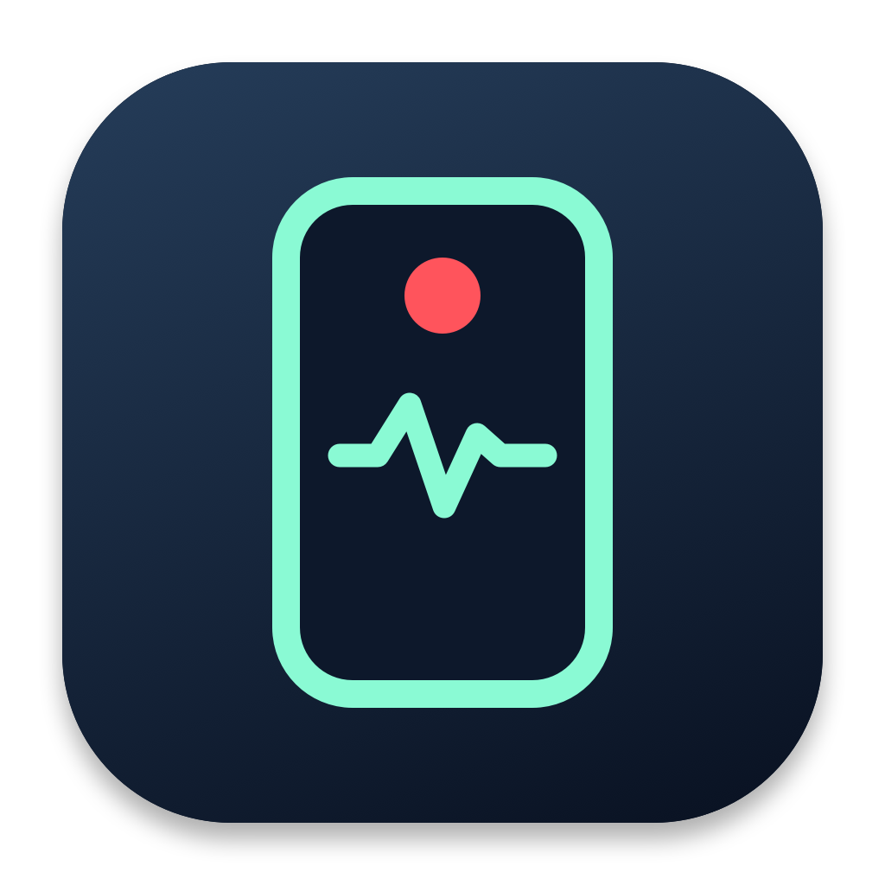

<p align="center">
  
</p>

<h1 align="center">iPhone Camera Catcher</h1>

<p align="center">
  <strong>Картинка с iPhone. Звук с микрофона MacBook или аудиоинтерфейса. Один файл на Mac.</strong>
</p>

<p align="center">
  <a href="https://github.com/ilichex/iPhoneCameraCatcher/actions/workflows/build-dmg.yml"></a>
  &nbsp; <strong>macOS 14.2+</strong>
</p>

Пишешь гитару, голос или урок для TikTok и Reels? Поставь iPhone на штатив, подключи микрофон к аудиоинтерфейсу и нажми **«Записать»** на Mac. Камера и звук попадут в один `.mov`, который можно сразу открыть в редакторе.

| Картинка | Звук | Результат |
| --- | --- | --- |
| Задняя камера iPhone через Continuity Camera | Focusrite Scarlett, другой аудиоинтерфейс или микрофон Mac | Один файл с видео и звуком в выбранной папке |

## Скачать и начать запись

[Скачать DMG для Apple Silicon](https://github.com/ilichex/iPhoneCameraCatcher/releases/latest/download/iPhoneCameraCatcher-macOS-arm64.dmg) · [Все релизы](https://github.com/ilichex/iPhoneCameraCatcher/releases)

Открой DMG и перетащи приложение в **Программы**. Сборка в GitHub рассчитана на Mac с Apple Silicon. У неё локальная подпись без нотариального заверения Apple.

1. **Подключи iPhone.** Включи на нём **Камеру Непрерывности** в настройках **Основные → AirPlay и Непрерывность**. Можно подключиться по USB или без провода. При USB подтверди доверие к Mac, затем заблокируй экран. [Требования Apple](https://support.apple.com/en-us/102546)
2. **Выбери микрофон.** Нажми **«Включить предпросмотр»**, разреши доступ к камере и микрофону. Выбери Scarlett в списке и проверь уровень, пока говоришь или играешь.
3. **Запиши дубль.** Нажми **«Записать»**, а после дубля — **«Остановить»**. Готовый файл можно показать в Finder. По умолчанию записи сохраняются в `~/Movies/iPhone Camera Catcher`.

## Один микрофон, звук в обоих ушах

Шкалы **«Вход»** показывают разъёмы интерфейса, а **«В файле»** — ожидаемый звук слева и справа. Если в режиме «Как записано» звук идёт только с одной стороны, нажми **«Исправить»** рядом со шкалами. Кнопка включает «Авто» и обновляет предпросмотр. Её можно нажать и во время записи.

С одним микрофоном на Scarlett обычно движется одна шкала: она показывает физический вход. Если установлен FFmpeg, режим **«Авто — исправить звук с одной стороны»** при сохранении копирует односторонний сигнал в левый и правый каналы. Когда сигнал есть с обеих сторон, сохраняется исходное стерео. Для ручного выбора входа есть меню **«Звук в файле»**.

Если FFmpeg ещё не установлен, с [Homebrew](https://brew.sh/) его можно добавить командой `brew install ffmpeg`. Для обработки потребуется временное место под вторую копию файла. Видео переносится без перекодирования.

## Видео iPhone со звуком и эффектами Ableton

1. В **Ableton → Settings → Audio** выбери Scarlett для входа и выхода. На аудиодорожке выбери вход микрофона, включи **Monitor In** или вооружи дорожку с **Monitor Auto**, добавь эффекты. Направь дорожку в **Main/Master**, выход **1/2**.
2. В приложении выбери iPhone как камеру. В разделе **«Системный звук»** выбери тот же выход Scarlett. В меню **«Звук в файле»** выбери **«Только звук программ (Ableton)»**.
3. Разреши запись системного звука, если macOS спросит. Уровень **«Программы»** должен двигаться, когда играет Ableton. Если разрешение отклонено, проверь приложение в **Системные настройки → Конфиденциальность и безопасность → Запись экрана и системного аудио**.
4. Нажми **«Записать»**. При остановке приложение сохранит видео iPhone с обработанным стереозвуком в одном MOV. Для объединения нужен FFmpeg (`brew install ffmpeg`).

Наушники остаются подключёнными к Scarlett. Чтобы слышать обработку Ableton, выключи Direct Monitor на интерфейсе. Захватывается весь звук выбранного выхода, включая другие программы.

При ошибке объединения исходное видео и отдельная дорожка программ остаются в папке записи. Для системного звука требуется macOS 14.2+. На macOS 15.2+ начало дорожки привязывается к временной отметке первого кадра. Перед длинным дублем проверь хлопок на короткой записи.

## Кадр и качество

- **Для TikTok и Reels.** Проверь кадр в предпросмотре и оставь запас для кадрирования в 9:16 при монтаже. Continuity Camera может отдавать горизонтальный поток даже с вертикально установленного телефона. Если нужен весь вертикальный кадр как в штатной «Камере» iPhone, запиши оригинал на телефон.
- **Разрешение и частота.** Выбирай из режимов, которые предлагает камера. При тесном кадре выключи **«В центре внимания»** и проверь масштаб в системном меню **«Видео»**.
- **Фокус и экспозиция.** С совместимой камерой можно кликнуть по кадру перед записью, чтобы выбрать точку фокуса и замера света. Приложение показывает, какие настройки доступны. У iPhone в режиме Continuity Camera эти команды могут быть недоступны.
- **Кодек.** Выбери **HEVC** для более компактного файла или **ProRes** для монтажа, если его поддерживает твой Mac.

## Собрать на Mac

Нужны Apple Command Line Tools (`xcode-select --install`). Запусти из папки проекта:

```sh
./build-dmg.sh
```

DMG и приложение появятся в `dist/`. Для сборки только приложения запусти `./build.sh`. После пуша в `main` или ручного запуска DMG доступен в **Artifacts**. При пуше тега версии, например `v0.1.0`, GitHub публикует DMG в **Releases**. [Спецификация проекта](SPEC.md)
